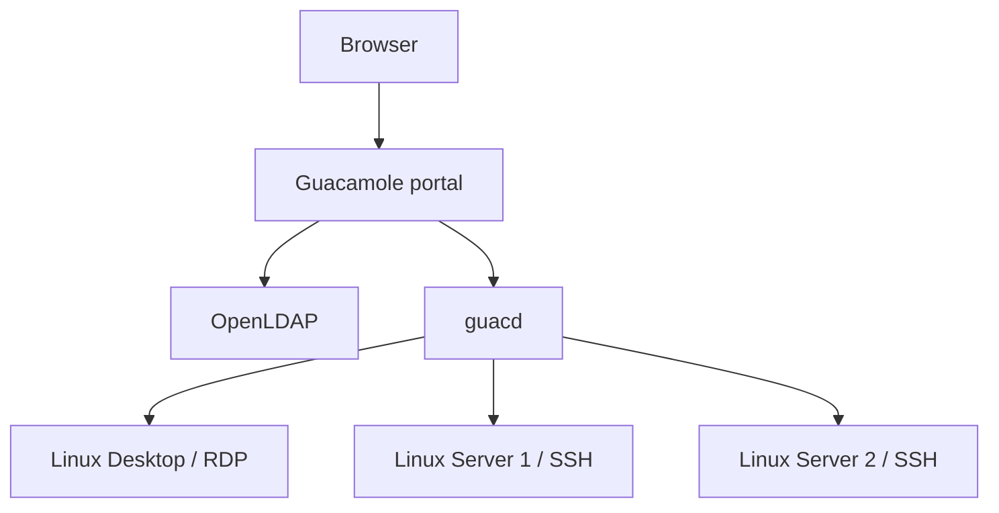

# SSH and RDP Gateway — Apache Guacamole playground

A local Docker Compose deployment with **LDAP-only portal identities and group-based access**, one Linux RDP desktop, and two Linux SSH servers. The three target machines are containers, not full virtual machines.

## Start

Prerequisites: Docker Engine with Docker Compose v2, or Docker Desktop running Linux containers. Allow approximately 4 GB RAM and several GB of disk space; the first desktop image build downloads XFCE and Xorg.

From this directory:

```bash
cp .env.example .env
docker compose up -d --build
docker compose ps
```

In PowerShell, replace the first command with `Copy-Item .env.example .env`.

Open **http://localhost:8080/guacamole/** after startup. If port 8080 is occupied, change `PORTAL_PORT` in `.env`, then run `docker compose up -d` and use that port.

| Portal username | Demo password | LDAP group | Available machines |
| --- | --- | --- | --- |
| `bob` | `Bob-Demo-2026!` | `SSH users` | Linux Server 1; Linux Server 2 |
| `alice` | `Alice-Demo-2026!` | `Desktop users` | Linux Desktop |

Use separate browser profiles, or sign out before changing users. Guacamole may open Alice's desktop automatically because she has only one connection. The Guacamole menu opens with **Ctrl+Alt+Shift**; use Home to return to the connection list.

There is no `guacadmin` portal login and no database to initialize.

## Architecture and access rules



1. Guacamole binds to LDAP using the person's username and password.
2. LDAP group membership determines which connection definitions Guacamole loads.
3. The user selects an authorized connection. Guacd connects to that target with its configured local NPA credentials.

Here, **NPA means non-personal account**: a service account on the target OS. Portal credentials are never passed through as target credentials.

| Target / Compose service | Protocol | Local target account | Password setting |
| --- | --- | --- | --- |
| `linux-desktop` | RDP, 3389 | `npa_desktop` | `NPA_DESKTOP_PASSWORD` |
| `linux-server-1` | SSH, 22 | `npa_ssh1` | `NPA_SSH1_PASSWORD` |
| `linux-server-2` | SSH, 22 | `npa_ssh2` | `NPA_SSH2_PASSWORD` |

The desktop runs Ubuntu 24.04, XFCE, Xorg and xrdp. The servers run Ubuntu 24.04 and OpenSSH. The targets have no LDAP authentication packages or LDAP user accounts. The local NPA accounts have no sudo access.

Only `127.0.0.1:8080` is published. LDAP, guacd, SSH and RDP have no host port mappings. LDAP has its own internal network; target containers use a separate internal runtime network. Target sessions do not have outbound internet access in this playground.

## Where the LDAP RBAC is defined

The complete seed is in `ldap/seed.ldif.template`:

| LDAP location | Contents |
| --- | --- |
| `ou=people,dc=example,dc=org` | Bob and Alice, as `inetOrgPerson` entries |
| `ou=groups,dc=example,dc=org` | `Desktop users` and `SSH users`, as `groupOfNames` entries |
| `ou=connections,dc=example,dc=org` | The three machine definitions, as `guacConfigGroup` entries |

For example, the SSH access group contains Bob:

```ldif
dn: cn=SSH users,ou=groups,dc=example,dc=org
objectClass: groupOfNames
cn: SSH users
member: uid=bob,ou=people,dc=example,dc=org
```

Each SSH connection references that group:

```ldif
dn: cn=Linux Server 1,ou=connections,dc=example,dc=org
objectClass: guacConfigGroup
cn: Linux Server 1
member: cn=SSH users,ou=groups,dc=example,dc=org
seeAlso: cn=SSH users,ou=groups,dc=example,dc=org
guacConfigProtocol: ssh
```

**`seeAlso` is the group-to-connection mapping.** No connection contains Bob's or Alice's DN. The connection's `member` value is a group DN solely to satisfy the mandatory `groupOfNames` schema attribute; it does not directly grant access to a human user. `LDAP_GROUP_BASE_DN` enables Guacamole to resolve these group references.

There are exactly two business access groups. The three `guacConfigGroup` objects represent machines, not additional user roles. OpenLDAP ACLs also restrict reading each machine's parameters to its authorized group.

All users, business groups, memberships and connections are provisioned in LDAP. Nothing needs to be created in the Guacamole UI. No JDBC extension, Guacamole user rows, database group mirrors, or per-user connection permissions are used.

`cn=admin,dc=example,dc=org` is OpenLDAP's bootstrap/root DN. It is outside the portal user base and is not a third portal user.

## Verify

Run the smoke test:

```bash
docker compose --profile test run --rm verify
```

The test requires no Python installation on your host. It checks:

- Bob and Alice authenticate through the LDAP data source only.
- Bob sees exactly the two SSH connections; Alice sees exactly the RDP connection.
- Incorrect passwords and a target NPA used as a portal login are rejected.
- Knowing a forbidden connection's ID does not permit reading it or opening a tunnel.
- Each allowed connection opens a Guacamole tunnel and produces remote display instructions.

Display instructions alone do not prove that an XFCE desktop has finished loading. Complete this browser check to verify the actual target sessions and NPA identities:

| Login | Action | Expected result |
| --- | --- | --- |
| Bob | Open Linux Server 1; run `whoami; hostname` | `npa_ssh1`, then `linux-server-1` |
| Bob | Open Linux Server 2; run `whoami; hostname` | `npa_ssh2`, then `linux-server-2` |
| Alice | Open Linux Desktop; open XFCE Terminal; run `whoami; hostname` | `npa_desktop`, then `linux-desktop` |
| Bob | Look for Linux Desktop | Unavailable |
| Alice | Look for either Linux server | Unavailable |

To prove access is driven by group membership, run this optional script in Bash, WSL or Git Bash:

```bash
bash scripts/check-group-change.sh
```

It verifies the original access matrix, temporarily adds Bob to `Desktop users` in LDAP, verifies that a fresh Bob login sees all three machines, removes that membership, and verifies that a fresh login again sees only the two SSH servers. It never changes a connection definition. Its exit trap restores the added membership on normal errors or interruption.

**Sign out and sign back in after membership changes.** Existing Guacamole authentication contexts may retain their loaded connections; removing a group membership does not guarantee immediate termination of an already open session.

To inspect directory groups without exposing passwords:

```bash
docker compose exec ldap sh -c 'ldapsearch -x -LLL -H ldap://127.0.0.1:389 -D "cn=admin,dc=example,dc=org" -w "$LDAP_ADMIN_PASSWORD" -b "ou=groups,dc=example,dc=org" "(objectClass=groupOfNames)" cn member'
```

For manual membership changes, use `ldapmodify` with the same root DN. A `groupOfNames` entry must contain at least one `member`; deleting its final member without replacing it is a schema error.

## Persistence, configuration and reset

Named volumes retain LDAP data, each NPA's home directory and SSH host keys. Stopping/restarting the stack does not recreate users or reset group memberships:

```bash
docker compose down
docker compose up -d
```

The LDAP seed runs **only on an empty LDAP data volume**. Editing the LDIF template, Bob/Alice passwords, or NPA passwords in `.env` does not update existing LDAP entries. Target passwords are applied on each target startup, so changing just `.env` for an existing installation can make the target password differ from the saved connection password.

For a clean, disposable demo reset after changing initial settings:

```bash
# Deletes this playground's LDAP data, home directories and SSH host keys.
docker compose down -v
docker compose up -d --build
```

If preserving data, update LDAP user passwords / `guacConfigParameter` password values with `ldapmodify`, update the corresponding target password setting in `.env`, and recreate the affected target. Do not change the connection password without changing the target password. The root LDAP admin password is read from `.env` on each LDAP startup.

## Troubleshooting

```bash
docker compose ps
docker compose logs --tail=100 ldap guacamole guacd
docker compose logs --tail=100 linux-server-1 linux-server-2 linux-desktop
docker compose exec linux-desktop sh -c 'tail -n 80 /var/log/xrdp.log /var/log/xrdp-sesman.log'
docker compose exec linux-desktop pgrep -a -u npa_desktop xfce4-session
```

| Symptom | Check |
| --- | --- |
| Portal not ready | Initial image builds and Tomcat startup take time; check service health and logs. |
| Login fails after changing `.env` | The existing LDAP volume still contains the old user passwords. Update LDAP or reset the demo. |
| User sees no connections | Check group membership, `seeAlso`, `LDAP_GROUP_BASE_DN`, and sign in again. |
| SSH/RDP authentication fails | Saved LDAP connection password must match the local target NPA password. |
| RDP shows a login/error screen or blank desktop | Read xrdp and sesman logs. Verify the Xorg session and `xfce4-session` process; LDAP login success alone does not verify desktop startup. |
| Demo script was forcibly killed and Bob still sees the desktop | Remove Bob's member value from `Desktop users` with `ldapmodify`, then log in again. |
| Windows reports a shell script interpreter error | Preserve LF line endings; `.gitattributes` specifies them. |

## Playground scope

This is a localhost demonstration with public example passwords. HTTP and internal LDAP are unencrypted; RDP uses a local self-signed certificate with `ignore-cert=true`, and SSH host-key verification is not pinned. LDAP connection attributes store recoverable NPA passwords; an authorized group member with direct LDAP access could read the associated parameters. LDAP passwords themselves are salted hashes. Do not reuse real credentials or expose this configuration to the internet.

A production deployment would require trusted TLS/LDAPS, verified target certificates/host keys, managed NPA secrets, stronger network isolation, and session auditing appropriate to shared target accounts. Guacamole identifies the portal user, while the target OS sees the NPA.

## Project files and sources

- `compose.yaml`: six running services, private networks, persistent volumes and an optional verification service.
- `ldap/`: OpenLDAP image, Apache schema, group/connection seed, ACLs and startup renderer.
- `targets/desktop/`: XFCE/xrdp image and local PAM configuration.
- `targets/ssh/`: reusable SSH image, built once per local NPA username.
- `tests/smoke.py`: API, authorization and tunnel checks.
- `scripts/check-group-change.sh`: temporary LDAP membership-change demonstration.
- `VALIDATION.md`: checks performed before delivery and runtime limitations.

Guacamole and guacd are pinned to **1.6.0**. Their upstream images include the LDAP extension and SSH/RDP protocol support, respectively. The Guacamole LDAP schema is vendored unchanged; its upstream license and notice are in `third_party/`.

References:

- [Apache Guacamole 1.6.0 LDAP authentication and group mappings](https://guacamole.apache.org/doc/1.6.0/gug/ldap-auth.html)
- [Apache Guacamole Docker deployment](https://guacamole.apache.org/doc/1.6.0/gug/guacamole-docker.html)
- [SSH and RDP connection parameters](https://guacamole.apache.org/doc/1.6.0/gug/configuring-guacamole.html)
- [Upstream LDAP schema](https://github.com/apache/guacamole-client/blob/1.6.0/extensions/guacamole-auth-ldap/schema/guacConfigGroup.schema)
- [Docker Compose startup dependencies](https://docs.docker.com/compose/how-tos/startup-order/)
- [Ubuntu xrdp session configuration](https://manpages.ubuntu.com/manpages/noble/man5/sesman.ini.5.html)
